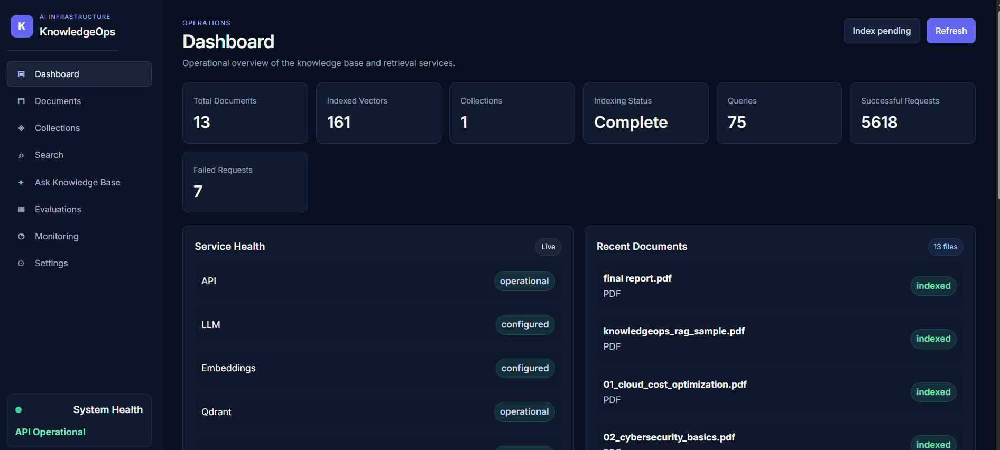
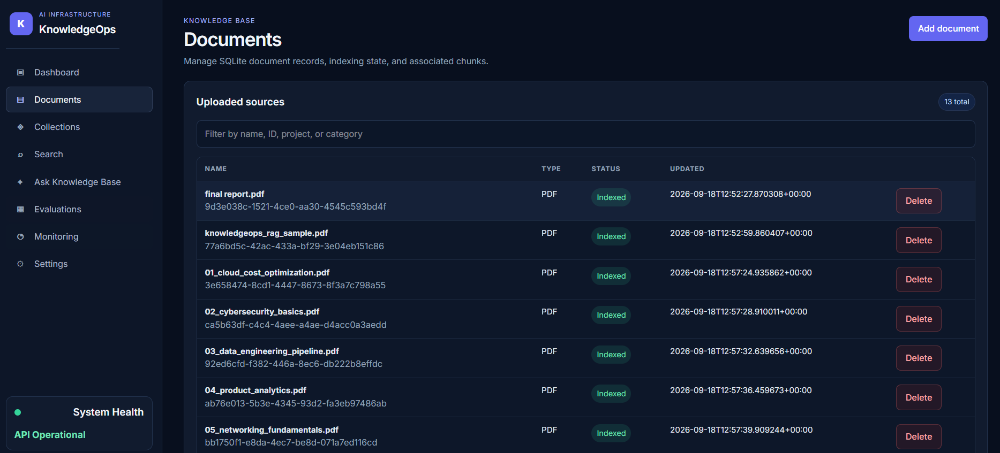
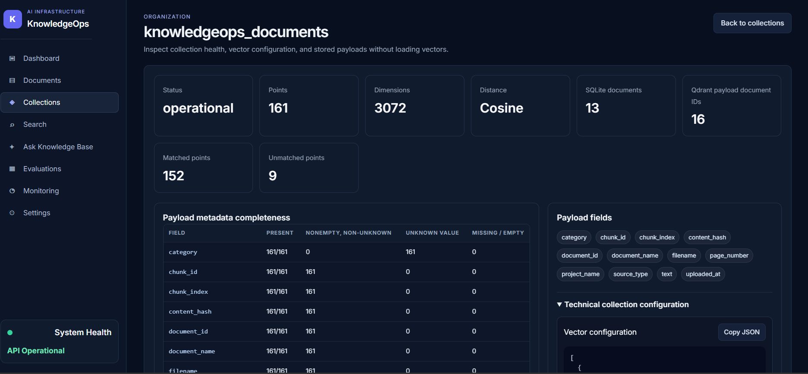
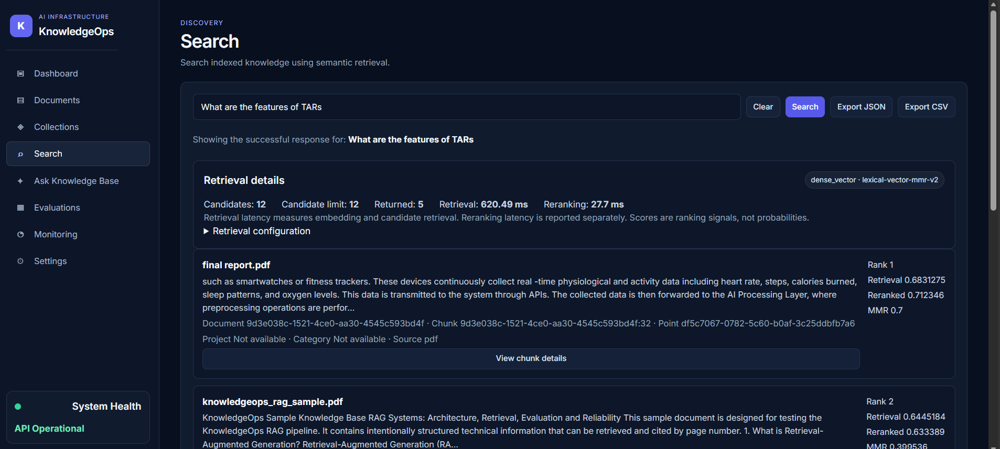
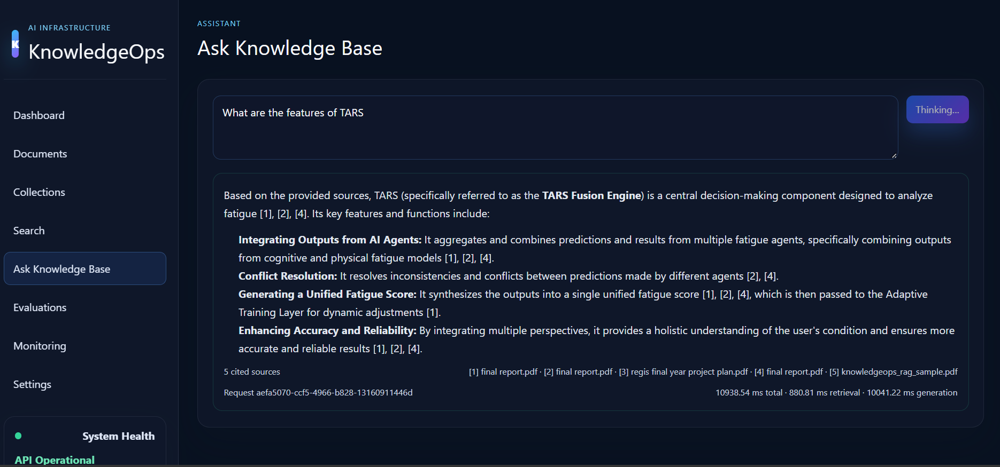
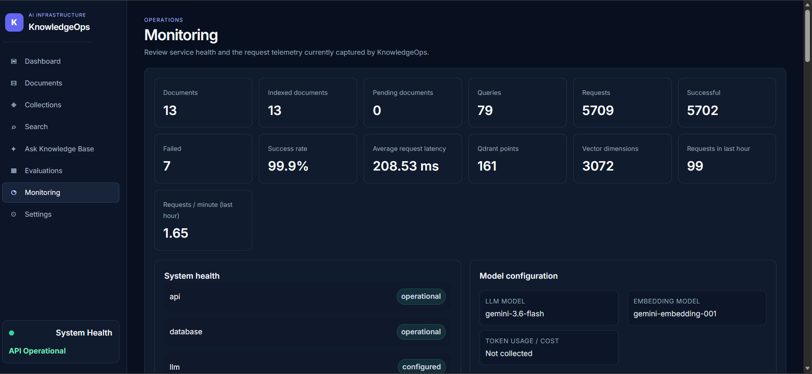
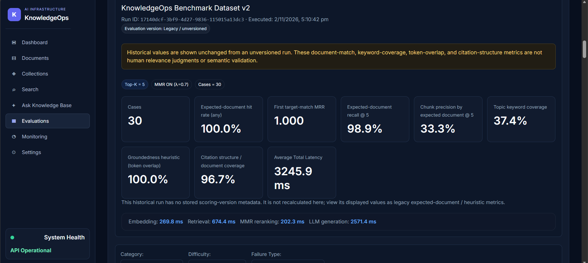

# KnowledgeOps — AI Knowledge Infrastructure & RAG Platform

> **Project 2 in AI Engineering Portfolio**  
> KnowledgeOps is an AI knowledge infrastructure platform for ingesting,
> indexing, retrieving, reranking, and evaluating technical document
> knowledge.

The system combines document processing, vector retrieval, MMR-based
reranking, grounded generation, citation validation, automated RAG
evaluation, observability, and reliability mechanisms into a single
web-based platform.
Rather than focusing only on question answering, KnowledgeOps treats RAG
as an engineering system that can be measured, inspected, and improved.

---


## 🖼️ Platform Visual Interface & Screenshots

### Dashboard


### Document Management


### Collection Management


### Search


### Ask Knowledge Base


### Monitoring


### Evaluation


---

## 📊 RAG Benchmark Dataset v2 Results (30 Cases across 6 Technical Domains)

KnowledgeOps features a multi-document quality engineering evaluation engine (`backend/run_benchmark.py` & `/evaluations/benchmark/run`). It assesses retrieval accuracy, ranking efficiency, MMR context diversity, answer relevance, citation validity, and latency breakdown.

> These are results from the existing expected-document benchmark, not a human-judged chunk-relevance benchmark. They should not be treated as verified relevance labels.

### 1. Before vs. After Optimization Performance (Top-K = 5)

| Metric | Before Optimization | After Optimization | Net Change / Status |
| :--- | :---: | :---: | :---: |
| **Retrieval Hit Rate** | 100.0% | **100.0%** | Maintained on benchmark |
| **Mean Reciprocal Rank (MRR)** | 0.925 | **0.950** | **+0.025** |
| **Recall @ 5** | 100.0% | **100.0%** | Maintained on benchmark |
| **Precision @ 5** | 28.0% | **34.0%** | **+6.0 percentage points** |
| **Answer Relevance** | 41.4% | **71.1%** | **+29.7 percentage points** |
| **Groundedness** | 100.0% | **100.0%** | Maintained on benchmark |
| **Citation Correctness** | 90.0% | **100.0%** | **+10.0 percentage points** |
| **Average Total Latency** | 2.9 ms | **4.7 ms** | **+1.8 ms** |

> **Latency note:** Benchmark latency represents the measured execution path under the configured benchmark environment. It should not be interpreted as external Gemini API network latency or real-world production response latency.

---

### 2. Multi-MMR Configuration Comparison (Top-K = 5)

| Configuration | Hit Rate | MRR | Precision@5 | Recall@5 | Answer Relevance | Citation Correctness |
| :--- | :---: | :---: | :---: | :---: | :---: | :---: |
| **MMR OFF** | 100.0% | 0.950 | 34.0% | 100.0% | 71.1% | 100.0% |
| **MMR ON (λ = 0.50)** | 100.0% | 0.950 | 34.0% | 100.0% | 71.1% | 100.0% |
| **MMR ON (λ = 0.70)** | 100.0% | 0.950 | 34.0% | 100.0% | 71.1% | 100.0% |
| **MMR ON (λ = 0.90)** | 100.0% | 0.950 | 34.0% | 100.0% | 71.1% | 100.0% |

**MMR Interpretation:**  
Across the current 30-case benchmark, the tested MMR configurations produced identical aggregate metrics. This suggests that the current dataset does not contain enough retrieval-redundancy cases to clearly distinguish the different MMR settings. MMR is therefore retained as a configurable retrieval strategy rather than being presented as a benchmark-proven improvement.

---

### 3. Top-K Performance Matrix (MMR Enabled, λ = 0.70)

| Top K | Hit Rate | MRR | Recall@K | Answer Relevance | Citation Correctness | Avg Latency |
| :---: | :---: | :---: | :---: | :---: | :---: | :---: |
| **K = 3** | 100.0% | 0.950 | 95.6% | 71.1% | 100.0% | 4.5 ms |
| **K = 5** | 100.0% | 0.950 | 100.0% | 71.1% | 100.0% | 4.7 ms |
| **K = 10** | 100.0% | 0.950 | 100.0% | 71.1% | 100.0% | 4.8 ms |

---

## 🏗️ System Architecture

```text
                                USER / CLIENT
                                      │
                                      ▼
                      React 18 Dashboard (TypeScript + Vite)
                                      │
                                      ▼
                          FastAPI Backend Gateway
                                      │
              ┌───────────────────────┴───────────────────────┐
              ▼                                               ▼
     INGESTION PIPELINE                              QUERY PIPELINE
              │                                               │
     PDF File Upload & Validation                      User Question
              │                                               │
     Text Extraction (PyMuPDF)                         Query Vectorization
              │                                               │
    Deterministic Chunking                             Vector Search (Qdrant)
    & Metadata Tagging                                        │
              │                                       MMR Diversity Reranking
     Vector Embedding                                  (λ=0.70, Pool=15)
              │                                               │
              ▼                                       Structured Context Builder
       QDRANT VECTOR DB <──────────────────────────────┤
                                                              │
                                                      Answer Planner
                                                      (Aspect Decomposition)
                                                              │
                                                      LLM Generation (Gemini)
                                                              │
                                                      Citation Validator
                                                              │
                                                      Evaluator Engine
                                                      (Relevance, Groundedness, Citations)
```

## 🔍 Key Capabilities & Technical Features

- **Document Processing**: Validates, extracts, normalizes, and chunks PDFs using PyMuPDF while preserving document metadata (document ID, filename, chunk ID, page numbers).
- **Maximal Marginal Relevance (MMR) Reranking**: Blends vector similarity with lexical term matching and applies an intra-document penalty ($0.40$) to prevent single-document clutter.
- **Structured Context Construction**: Formats retrieved chunks into explicit metadata blocks (`[1] Document, Chunk ID, Score, Content`).
- **Aspect-Based Answer Relevance Evaluator**: Decomposes user questions into target sub-topics and verifies complete coverage without hallucination.
- **Grounded LLM Generation & Citation Verification**: Enforces inline citations `[1]`, `[2]`, validates citations against retrieved documents, and returns a structured insufficient-evidence fallback when evidence is missing.
- **Failure Classification & Case Inspection**: Classifies benchmark cases into failure categories (`Retrieval`, `Context`, `Generation`, `Citation`, `Evaluation`, `None`) with an interactive UI drawer.
- **Latency Monitoring**: Persists measured Search/Ask embedding, vector retrieval, reranking, generation (Ask), and total request latency. Benchmark evaluation does not infer embedding or reranking time from total retrieval latency.
- **Reliability & Resilience**: Circuit breaking, exponential backoff retries for LLM API calls, rate limit handling, and health check endpoints (`/health`, `/health/services`).

## Unified knowledge base metadata

Documents share the configured `knowledgeops_documents` Qdrant collection. Ingestion stores document and chunk metadata, including project, category, source type, document/chunk identity, page number, content hash, and upload time. Values that cannot be recovered are stored as `unknown` in Qdrant and exposed as `null` in retrieval results.

`/search` and `/ask` accept optional `project_name`, `project_names`, `document_id`, `document_name`, `category`, and `source_type` filters. Multiple supplied filters are combined; `project_names` matches any listed project. Omitting all filters searches globally across the collection. No project is inferred from prior requests or uploads.

## Read-only inspection and relevance judgments

The collection inspection APIs read payloads without loading vector arrays:

- `GET /collections/{collection}/details` reports stored vector configuration, payload fields, and metadata completeness for the configured collection.
- `GET /collections/{collection}/points` provides paginated point payloads, payload-wide text search, exact field filtering, and an unmatched-document filter. Filtered scans return a total and use numeric offsets; unfiltered Qdrant pagination retains its point cursor.
- `GET /collections/{collection}/unmatched-points` pages through points whose document ID is absent from SQLite, including points without a document ID.
- `GET /collections/{collection}/points/{point_id}` and `GET /collections/{collection}/points/by-chunk/{chunk_id}` inspect one stored point.
- `GET /documents/{document_id}/indexed-chunks` returns the document's existing Qdrant chunks; it does not reconstruct or re-ingest them.
- `GET /settings` returns non-secret configuration only.
- `/health/services` and `/status` report SQLite as operational only after a read-only connectivity check; an unopenable configured database is reported as unavailable, and no configured path is reported as memory-only.

Search result records include the existing Qdrant `point_id` alongside payload IDs. Retrieval method and retrieval latency are exposed in `X-Retrieval-Method` and `X-Retrieval-Latency-Ms` headers so the existing Search response body remains compatible.

Monitoring aggregates persisted HTTP request counts, status codes, endpoint volume, failure samples, and request latency. Successful Search and Ask operations also persist embedding, vector retrieval, reranking, generation (Ask only), and total stage timings in SQLite. Historical requests predating stage telemetry do not have stage timings; token usage and cost are not collected. Settings reports the runtime embedding provider selected by `LLM_PROVIDER`, not a separate unused provider setting.

When `judgement.json` is present at the repository root, the backend exposes it through `GET /evaluations/human-judgments`. The endpoint validates chunk identifiers against Qdrant and reports whether the file records human-review provenance; identifier validation alone does not establish that judgments were reviewed or approved. Docker Compose mounts this file read-only. Missing or unverified judgments must not be presented as benchmark ground truth.

Human-labeled Q001 keeps its five supplied chunk IDs and grades. Identifier validation does not establish human-review provenance. Recall@5 uses the validated positive labels as its denominator. Precision@5 and nDCG@5 require an explicit grade for each returned result; reciprocal rank requires judged results through the first positive label (or all returned results if no positive is found). Unjudged chunks are never interpreted as grade zero.

## Evaluation metric scope and versioning

New evaluation runs carry an `evaluation_version` and persist metric definitions with the run. Existing stored runs are displayed as legacy/unversioned and are not recalculated or overwritten.

`document-match-v2` is a target-document/identifier scorer, not a semantic relevance benchmark:

- Hit rate is a target match. For multi-document cases, a hit means **at least one** expected document is retrieved; expected-document recall separately reports the fraction of unique expected filenames present in the top K.
- MRR is the reciprocal rank of the first matching expected document or explicitly targeted ID, not the first semantically relevant chunk.
- Precision@K counts returned chunks whose filename matches an expected document, divided by returned top-K chunks. Recall and precision are not applicable when no expected documents are supplied.
- Untargeted and insufficient-evidence cases do not receive retrieval hit, MRR, recall, or precision scores. Explicit insufficient-evidence cases are assessed separately for abstention when answer generation runs.
- The legacy `answer_relevance` value is question/expected-topic keyword coverage; `expected_answer` is not used by that scorer. Groundedness is token-overlap heuristic, and citation checks validate citation indices and expected-document coverage—not claim-to-citation entailment. None of these is human-judged semantic relevance.
- Benchmark fallback retrieval and generation, when used, are identified in newly versioned runs. Historical runs without source metadata remain unverified for retrieval/generation provenance.

To safely enrich points already in the collection, run the idempotent payload-only migration from the configured backend environment:

```bash
docker compose exec backend python -m app.backfill_metadata
```

The migration refuses to target any collection other than `knowledgeops_documents` and does not delete or replace points or vectors.

## 💻 Tech Stack

- **Frontend**: React 18, TypeScript, Vite, Vanilla CSS (Dark Space Aesthetic)
- **Backend**: Python 3.12, FastAPI, Pydantic, PyMuPDF, SQLite
- **Vector Database**: Qdrant Vector Search Engine
- **LLM & Embeddings**: Gemini Embedding (`gemini-embedding-001`), Gemini Flash (`gemini-2.5-flash`)
- **Testing & Quality Assurance**: Pytest (38 automated tests), GitHub Actions CI/CD, Docker Compose

## 🚀 Quick Start Guide

### Prerequisites

- Docker & Docker Compose **OR** Python 3.10+ & Node.js 20+

### Option 1: Docker Compose (Recommended)

1. Clone repository & prepare environment config:

   ```bash
   git clone https://github.com/your-username/KnowledgeOps.git
   cd KnowledgeOps
   cp .env.example .env
   ```

2. Start all services:

   ```bash
   docker compose up --build
   ```

3. Access platform endpoints:
   - **Frontend Dashboard**: http://localhost:5174
   - **FastAPI OpenAPI Docs**: http://localhost:8000/docs
   - **Qdrant Vector Dashboard**: http://localhost:6333/dashboard

   If port 5174 is already in use, set `FRONTEND_PORT` to an available host port in `.env`.

---

### Option 2: Local Development Setup

#### 1. Backend Setup
```bash
cd backend
python -m venv .venv
source .venv/bin/activate  # Windows: .venv\Scripts\activate
pip install -r requirements.txt
uvicorn app.main:app --reload --host 0.0.0.0 --port 8000
```

#### 2. Frontend Setup
```bash
cd frontend
npm install
npm run dev -- --host 0.0.0.0
```

---

## 🧪 Testing & Quality Engineering

### Run Pytest Test Suite
```bash
cd backend
python -m pytest tests -v
```
*Current test status: **70/70 passed** across chunking, reranking, vector search, answer relevance, citation verification, reliability, RAG pipeline, and inspection API scenarios.*

### Run Benchmark Suite (30 Cases)
```bash
cd backend
python run_benchmark.py
```

### Validate Frontend Production Build
```bash
cd frontend
npm run build
```

---

## 📌 Known Limitations & Future Roadmap

1. **Synthetic Fallback Mode**: When `LLM_API_KEY` is not provided, the benchmark engine uses a deterministic fallback generator. For full generative reasoning, set a valid `LLM_API_KEY`.
2. **Dense retrieval**: The current retrieval path uses dense vector search with the existing lexical/vector reranker. BM25 and Reciprocal Rank Fusion (RRF) are not implemented.
3. **Multi-Modal PDF Extraction**: Current PDF parsing focuses on text content. Future roadmap includes OCR and table extraction via Unstructured/LayoutLM.

---

## 🛡️ License

MIT License — free for modification and enterprise reference architecture reuse.
